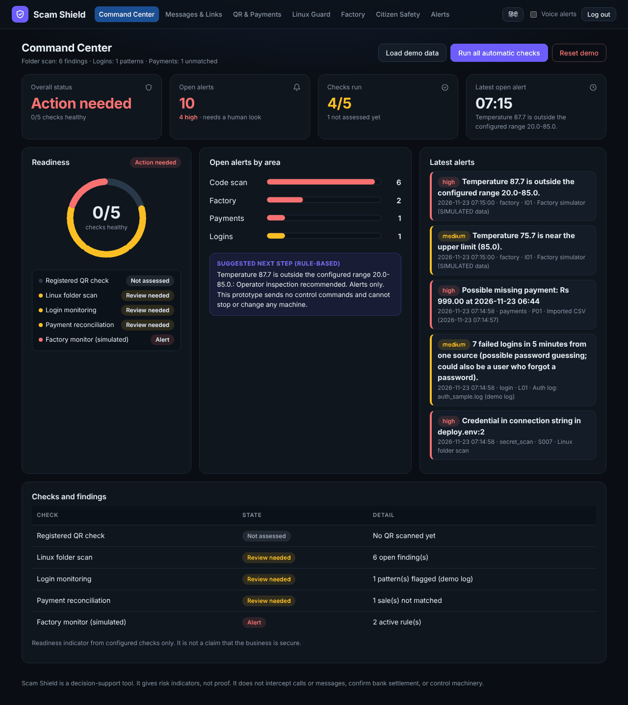
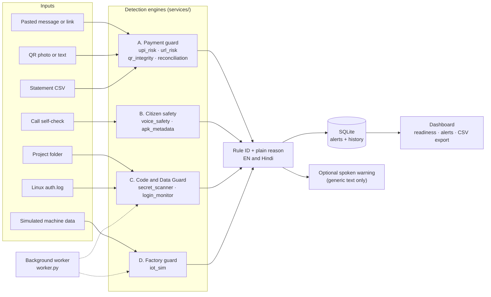
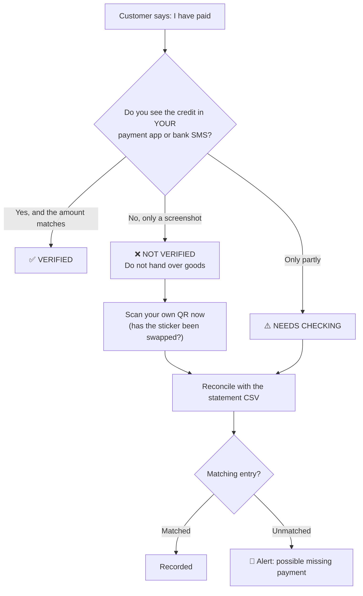
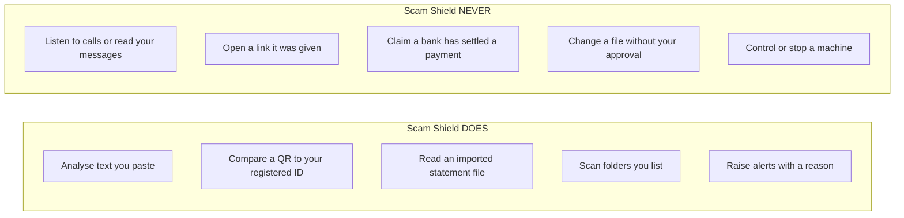
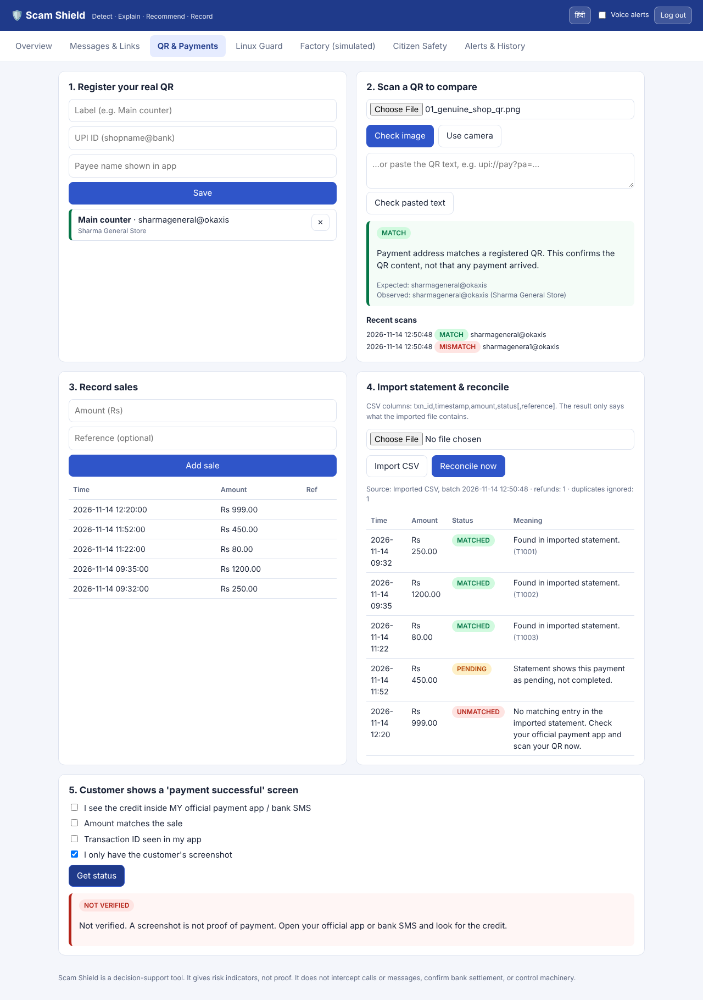
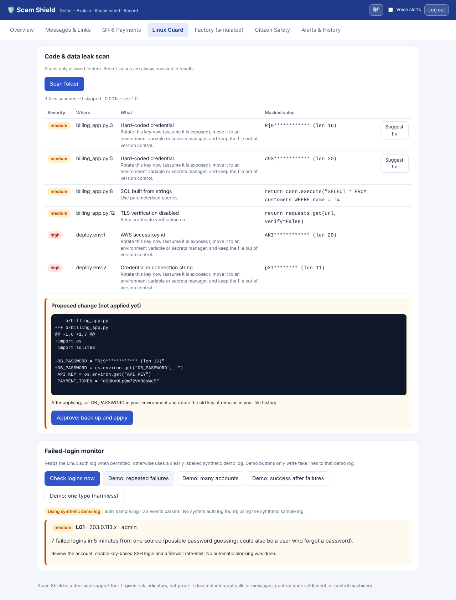
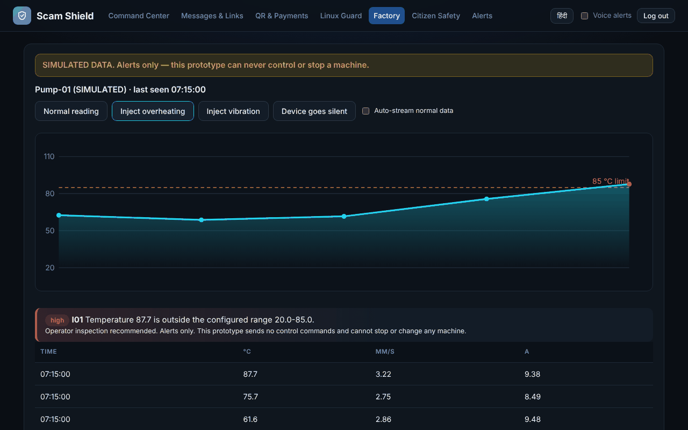
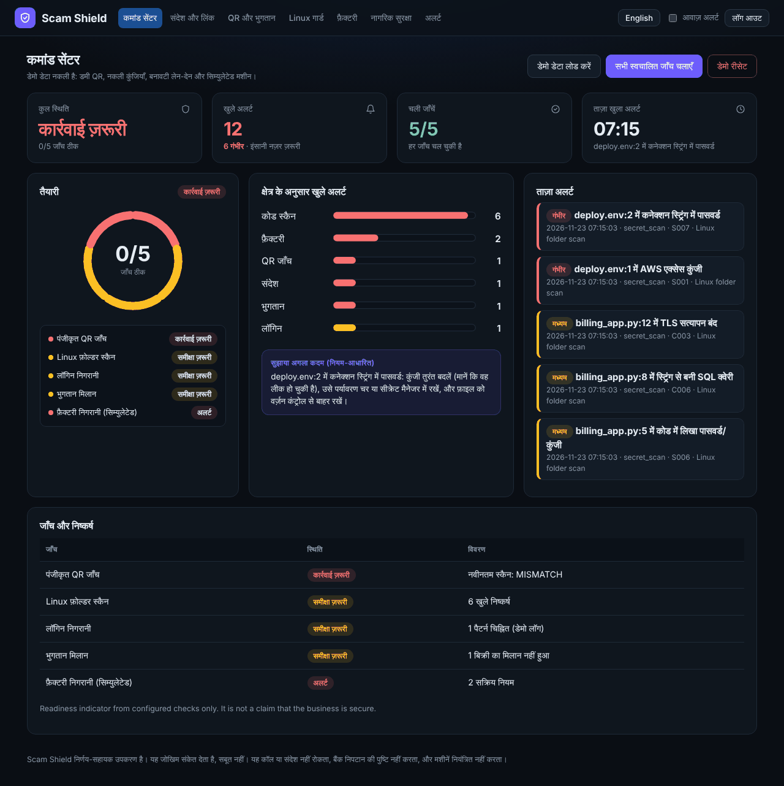

<div align="center">

# 🛡️ Scam Shield

### Spot the scam before the money moves.

A local-first, **Linux-based** cyber-safety dashboard that protects shops, families and small factories.<br>
**Detect → Explain → Recommend → Record**, in English and Hindi.


*Built for **Track 3: Cyber Safety. Protecting People, Shops & Factories from Scams.***

[Features](#-features) · [How it works](#-how-it-works) · [Run it](#-run-the-linux-app) · [Phone version](#-try-it-on-your-phone) · [Results](#-tests-and-measured-results) · [Limits](#-honest-limits)



</div>

---

## 💡 The problem

A shopkeeper looks at a customer's "payment successful" screenshot. A QR sticker on the counter has been swapped. A WhatsApp message says "KYC pending, enter your UPI PIN to receive a refund". A developer pushes a database password to a shared folder. A pump runs hot and nobody is told.

These look like different problems, but each one is a person making a money or safety decision with too little information. Scam Shield gives them that information fast, in their own language, with a reason they can understand.

## ✨ Features

| | Feature | What it does |
|---|---|---|
| 💬 | **Message and link check** | 13 explainable rules for fake refunds, PIN and OTP requests, collect-request tricks, urgency, remote-access apps and fee scams. Links are **never opened** |
| 🔳 | **QR integrity check** | Compares a scanned QR with your registered UPI ID. Catches look-alike swaps, different payees, shortened links and name mismatches |
| 🧾 | **Payment reconciliation** | Matches your sales to a statement CSV. Handles duplicates, refunds, pending, failed and ambiguous entries |
| ✅ | **Payment verification** | "Customer shows a success screen" checklist. A screenshot alone is **never** "Verified" |
| 🔐 | **Code and data guard** | Finds hard-coded secrets and risky code. Secrets are always masked. A fix needs your approval, shows a diff and keeps a backup |
| 🖥️ | **Login monitor** | Reads Linux `auth.log` for repeated failures, account probing and success after failures. One typo is never an attack |
| 🏭 | **Factory guard** | Simulated machine data with four anomaly rules. **Alerts only. No control path** |
| 📞 | **Citizen safety** | Call-back steps and a self-check for voice-clone and family-emergency scams. No call is ever recorded or listened to |
| 📦 | **APK review** | Reads app metadata and permissions. The file is never installed or run |
| 📊 | **Readiness table** | Shows what was checked and when. A check that has not run says **Not assessed**. No hidden percentage |

## 🧭 How it works

Everything flows through one pipeline. Each engine produces findings with a rule ID, a reason and a recommended action. Only then are they recorded.



### Is this payment real? The decision flow

The core idea for shops: **trust your own app or bank, never the customer's screen.**



### Safe by design: what the tool can and cannot do



## 📸 Screenshots

<table>
<tr>
<td width="50%"><b>QR integrity and payments</b><br></td>
<td width="50%"><b>Linux code and login guard</b><br></td>
</tr>
<tr>
<td width="50%"><b>Factory guard (simulated)</b><br></td>
<td width="50%"><b>Hindi interface</b><br></td>
</tr>
</table>

## 📱 Try it on your phone

`web/index.html` is a **single-file** version of the dashboard that runs entirely in the browser. Nothing is uploaded or stored.

- Open the GitHub Pages link: `https://YOUR-USERNAME.github.io/scam-shield/web/`
- Or open `web/index.html` directly in any browser.

Folder scanning, the real login log, the background worker and the APK check are Linux-only. In the phone version you paste a file or log lines, or use the sample buttons.

## 🚀 Run the Linux app

Requires Python 3.10+ on Ubuntu or any Linux.

```bash
python3 -m venv venv && . venv/bin/activate
pip install -r requirements.txt
python make_samples.py     # synthetic demo data: fake QR codes, fake keys, made-up transactions
python app.py              # http://127.0.0.1:5000
```

The first visit asks you to create the owner account. Then go to **Overview → Load demo data → Run all automatic checks**. A 5-minute demo walkthrough is in [`docs/DEMO_SCRIPT.md`](docs/DEMO_SCRIPT.md).

<details>
<summary><b>Automatic monitoring, real logs and your own folders</b></summary>

**Background worker** (monitoring without opening the dashboard)

```bash
python worker.py --once          # one pass (cron friendly)
python worker.py --interval 60   # loop
# or install docs/scam-shield-worker.service as a systemd user service
```

**Reading the real login log:** run as a normal user in the `adm` group (`sudo usermod -aG adm $USER`, then log out and in). Without permission the app says so and uses a clearly labelled demo log. It never pretends monitoring is active.

**Scanning your own folder:** `SCAM_SHIELD_SCAN_ROOTS=/home/you/myproject python app.py`. Only listed folders, plus the bundled sample folder, can ever be scanned.

</details>

## 🧪 Tests and measured results

```bash
python -m pytest -q        # 61 tests
python -m tests.metrics    # re-measures and rewrites docs/TEST_REPORT.md
```

| Check | Cases | Result |
|---|---|---|
| Message analyser | 61 (including 6 hard cases) | precision **93.1%** · recall **90.0%** · false alarms **6.5%** |
| Message analyser, without hard cases | 55 | precision **100%** · recall **100%** |
| Link risk | 26 | recall **100%** · false alarms **0%** |

> **Read this honestly.** The labelled sets are small and written by the authors. These numbers are a prototype sanity check, **not** a real-world accuracy claim.

Known misses: parcel-link scams, the "son arrested" bail scam, and Aadhaar/PAN photo requests. Known false alarms: a loyalty "reward points" message and an awareness tip about collect requests. Details are in [`docs/TEST_REPORT.md`](docs/TEST_REPORT.md).

## 🔒 Security design

| | |
|---|---|
| **Access** | Owner login, hashed password, login throttling, binds to `127.0.0.1` by default |
| **Requests** | CSRF token on every state-changing request, HttpOnly and SameSite cookies, strict Content-Security-Policy with no inline scripts |
| **Files** | Upload size and type limits, uploads never executed, scan-folder allow-list, path-traversal and symlink-escape blocked |
| **Data** | Secrets masked in alerts, API and diffs. Pasted text is analysed but not stored. CSV export is spreadsheet-injection safe |

The full 24-item checklist, with the test behind each item and four items openly marked **Not done**, is in [`docs/SECURITY_CHECKLIST.md`](docs/SECURITY_CHECKLIST.md).

## ⚠️ Honest limits

- Rule-based indicators. A brand-new scam wording can be missed.
- It cannot confirm anything with a bank. Reconciliation only says what the **imported file** contains.
- It cannot see a physical sticker. It detects that the QR being scanned is not the registered one.
- The factory module uses simulated data and has no way to control a machine.
- Voice-call detection is **not** attempted. The app teaches call-back verification instead.
- Live camera QR scanning uses the browser `BarcodeDetector` API (Chromium-based browsers). Image upload and pasted text work everywhere.
- Not yet validated on a real `auth.log`, a real APK, or real bank statement exports. The formats are tested on synthetic data only.
- Hindi text was written for this project and should be reviewed by a native speaker before public release.
- HTTPS, multiple users, database encryption and an independent security review are not done. The dev server is not for the internet. For phone access on a trusted network, put it behind a reverse proxy with HTTPS.

## 🤝 Responsible use

All demo data is synthetic: dummy QR codes, fake keys, made-up transactions, generated log lines and a simulated machine. Do not point the login monitor, scanner or any part of this tool at accounts, systems or devices you do not own.

## 🗂️ Project layout

```
app.py  runners.py  worker.py  config.py  db.py  make_samples.py
services/      detection logic, independent of Flask (unit-tested)
templates/ static/    dashboard (no inline JS, CSP-safe)
web/           single-file phone version (runs in the browser)
tests/         dataset.py  test_detection.py  test_modules.py  test_app.py  metrics.py
sample_data/   synthetic demo files
docs/          test report, security checklist, demo script, architecture, img/
```
